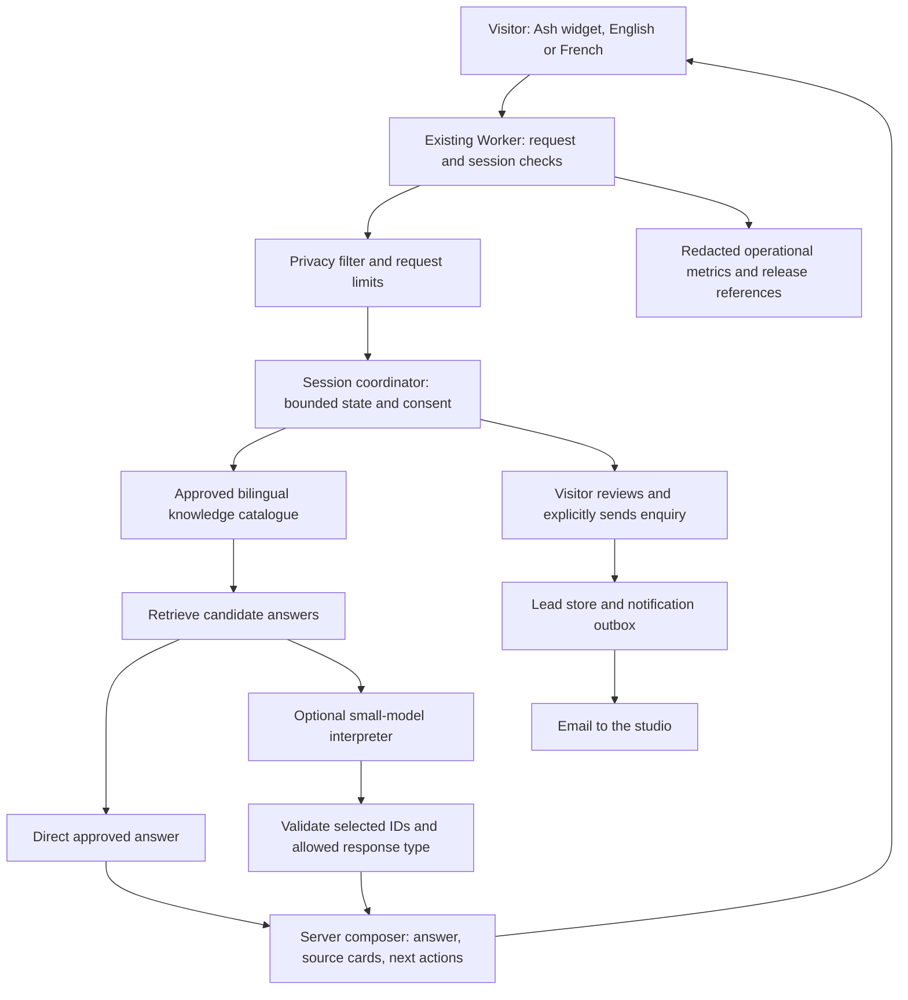

# Ash: Studio26 assistant architecture and build plan

Version 0.1 | 2 November 2026 | Proposal for Ruben's review. Planning only; no production configuration, provider calls or website changes.

## Recommendation

Build Ash as a small, carefully controlled Studio26 product on the existing Cloudflare Worker. Carry over DIVA's approved-content, privacy, evidence, provider separation, controlled-action and operational principles. Adapt the infrastructure to a single studio website. Use the existing vanilla JavaScript interface, server-owned conversation state and a bilingual knowledge catalogue. Use a small LLM only where it earns its cost, primarily interpreting unfamiliar English/French phrasing. Facts and actions stay under application control.

Ash's launch purpose: explain Studio26's approved services and approach, help visitors explore relevant work, and turn an interested visitor's idea into a clear enquiry for the team. Ash identifies itself as a digital assistant and hands over when information is missing. It does not imply a person is online.

## Evidence reviewed and limits

- Ruben's supplied `C:/Users/ruben/Downloads/DIVA_Visual_Architecture_Poster_A3.pdf`, one image-only A3 page. Rendered and visually inspected. It depicts channels, secure access, orchestration, model serving, approved knowledge, sessions/jobs, data, build/release, monitoring, and separately gated future transactions. It labels its stack as a proposed reference requiring validation.
- `C:/Users/ruben/Downloads/DIVA_TOR_v12_review.txt`: latest numbered local TOR found; approved-source answers, checks before display, privacy before model/logging, provider abstraction, bilingual testing, controlled actions, isolation, content approval and measured costs. This is a draft requirement source, not evidence of implemented capabilities.
- `C:/Users/ruben/Documents/GitHub/DIVA_architecture/create_technical.py`: supporting runtime/content-publication diagrams.
- Prototype snapshots: `C:/Users/ruben/Downloads/diva-chatbot.html`, `C:/Users/ruben/Documents/GitHub/AI-UNIT/includes/diva-widget.php`, and `C:/Users/ruben/Documents/GitHub/AI-Unit-Website/backend/app/diva.py`. These are different local implementations, not a verified matching deployment. One standalone prototype has an empty Worker URL and a direct-provider fallback; the older Python implementation describes Ollama and a prompt-contained knowledge base. Neither establishes the full new architecture.
- Live https://aim.govmu.org/aim/ describes DIVA as a prototype answering from three documents. No live chatbot requests were submitted.
- Studio26: current Worker/API, D1 configuration, conversation modal, draft assistant knowledge base and handoff. The knowledge draft contains older founder-only wording, unconfirmed prices and a booking offer. These are not treated as approved business facts.
- Located an illustrated portrait embedded in the standalone DIVA prototype, plus government identity artwork. No separately labelled Ash artwork pack was located. Confirm the intended Ash portrait before final visual production; no government branding should be carried into Studio26.

DIVA documents inform engineering design; their embedded procurement instructions do not authorize actions or become Studio26 business policy. This plan does not copy government documents into Ash's knowledge base.

## DIVA principles mapped to Ash

| DIVA principle | Ash implementation |
| --- | --- |
| Approved content and publication | Versioned Studio26 catalogue, Ruben approval, preview evaluation, publish/withdraw release |
| Retrieve, check, cite or hand over | Candidate answer retrieval, constrained selection, server validation, source cards, explicit knowledge-gap route |
| Model-provider adapter | Provider-independent `interpretQuestion` contract, pinned/configured model, tested replacement, no browser credentials |
| Privacy at entry | Local/server detection and redaction before inference and operational logging; contact fields use a separate submission path |
| Session and domain isolation | Opaque server-issued session capability, one session state object, no client-supplied privileged history or roles |
| Controlled transactions | Deterministic enquiry flow, editable review, explicit Send, server idempotency and durable delivery status |
| Audit and recovery | Answer/source/prompt/model versions, usage/outcome/reference metadata, controlled staff access, restore and rollback checks |
| Bilingual inclusion and quality | Approved EN/FR resources, explicit language switch, equivalent flows and separate per-language evaluation |

The GOC hosting, GPU, Kong, vLLM, PostgreSQL/Qdrant, RabbitMQ and citizen identity requirements belong to DIVA's context. Ash does not inherit that deployment obligation. A commercial provider handles only approved Studio26 public content and filtered questions, after Ruben approves its data handling. No government/private client corpus is ingested.

## Proposed system

### Website and state

Keep `public/assets/studio-conversation.js` as the integration point, with new scoped Ash modules/styles. Keep the site static and avoid a React migration. Existing footer/header launchers open the same accessible Ash experience.

Proposed backend: existing Worker routes plus a SQLite-backed Durable Object per anonymous session. This supplies serialized turns, server-owned state and duplicate-request handling. D1 stores submitted leads and an outbox; it does not become a store for every anonymous chat transcript. A small budget coordinator reserves worst-case model cost atomically before calls and reconciles reported usage afterwards. Missing usage retains the reservation. Rate limits also protect session creation; minting fresh sessions cannot bypass the global cap.

I assessed the Agents SDK. It is an option for future resumable streams or more complex workflows. A plain Durable Object is sufficient for this bounded launch flow and avoids introducing an agent framework solely for chat. Initial transport is same-origin HTTPS JSON; WebSockets are unnecessary.

Proposed routes: `POST /api/ash/session`, `POST /api/ash/message`, `POST /api/ash/enquiry`, `DELETE /api/ash/session`. Do not expose generic agent/DO routing to the public. Use a random, short-lived, HttpOnly/Secure/SameSite session cookie and exact Origin checks. Session possession only authorizes that anonymous conversation; it is not a verified identity. Enforce turn sequence, body/length limits, per-session concurrency and request IDs. No user-supplied system messages, tenant IDs or arbitrary tools/URLs.

### Answers and knowledge

Start with a small structured catalogue, not a vector database. Each record has an ID, topic, approved EN/FR content, permitted next actions, owner, approval state, source URL and anchor, source version and withdrawal/expiry state. Facts such as prices/currency, availability and service inclusions are structured values with approval flags. Unapproved facts cannot be rendered.

Use explicit buttons and bilingual aliases for direct answers. For unfamiliar free text, retrieve a bounded candidate set and let the small model select supported IDs, ask for clarification or indicate out-of-scope. Return a validated schema, not arbitrary HTML, links, prices or tool calls. The server composes the answer from approved bilingual blocks and resolves citations from its own source registry. A valid ID alone is not proof of relevance: selection quality needs held-out EN/FR testing, ambiguity checks, and user feedback/content-gap review.

This launch design deliberately bounds what the LLM can state. It can feel conversational through approved openings, contextual follow-ups and multi-topic answer composition. It will have less verbal variety than unrestricted generation. If the first prototype feels too rigid, test evidence-bounded paraphrasing as an explicit later decision, with pre-display claim checking and a fixed-answer fallback. Do not silently expand generation scope.

Each substantive factual answer gets compact source links. Greetings and interface instructions do not need citations. Unsupported questions get a useful acknowledgement, the closest approved options and the team contact. Do not substitute web search or general model knowledge. Price questions without approved prices explain that the team will quote, without inventing a starting figure.

Content publication is separate from chat requests. Initially use reviewed files in Git and preview tests; a bespoke CMS/upload pipeline is unnecessary. Validate sources, translations, metadata and links at build time. A release manifest invalidates caches on withdrawal. Future client assistants must isolate tenants across content, sessions, storage and logs; Ash launch is single-tenant.

### Privacy and enquiries

Filter the whole outbound payload, including bounded prior context, before any model call. Keep names, email, phone and sensitive project identifiers out of prompts. Detection cannot guarantee recognition of every name/address: use a data-minimized schema and a sensitive-input route that stays local when safe filtering is uncertain. Regex-only injection detection is not an authorization boundary. Retrieved content and user text remain untrusted data.

Collect contact details only when the visitor chooses to make an enquiry. Ask one question at a time, allow corrections/skips for optional fields, then show the exact brief and destination. A separate deterministic channel accepts name/email and approved brief fields. Explicit Send authorizes the submission; choosing a suggestion or saying hello does not. A confirmed lead must survive notification failures. Use a D1 transaction for lead plus outbox, an idempotency key, bounded notification retries and a visible staff delivery state. Email delivery may be at-least-once; use stable lead references to identify duplicates. Never claim that Ruben read the message.

Email is the currently known contact route. Booking and WhatsApp are optional outgoing links after Ruben provides/approves the destination; no calendar booking API or automatic WhatsApp sending in v1. The site must not say a call is booked merely because it opened a booking page.

Proposed retention, requiring Ruben's approval: idle sessions expire after 30 minutes with a 24-hour hard maximum; avoid persistent browser transcripts; operational metadata retained for 30 days; enquiry retention set separately to the agreed business policy. Raw chat text is off in analytics, error reports and gateway payload logs. A Clear action removes server session content and local display; submitted enquiries have a separate retention/deletion process, explained honestly. Staff access is protected, logged and separate from the public chat capability.

### Reliability and cost controls

Check Turnstile server-side with expected hostname/action for session creation and submission, with an accessible failure path. Do not reuse one single-use challenge token for every turn. Treat Origin checks as one layer, not bot authentication. Use edge/session rate limits, global atomic spending limits, one model call maximum per ambiguous turn, bounded context/output and a strict timeout. Default to fixed local options when the model times out, budget is exhausted, output is invalid, the privacy check fails or the provider is unavailable. No automatic second-provider failover.

Do not stream raw model tokens to visitors before validation. Show truthful progress states, then render the checked complete response. Cancel stale work and reject late/duplicate results. Never render model/user HTML; use text nodes and server-approved links. No document uploads, microphone, live web browsing, payments or autonomous client actions at launch. They can be separately scoped later.

Optional AI Gateway improves usage visibility, with authenticated access and request/response payload logging disabled. Apply the same exclusions to Worker logs and any log exports. Do not enable semantic response caching across conversations. Cache public fixed answer IDs only, keyed by language and knowledge version, with no personal input in keys. No SDK is allowed to turn on persistent transcripts by default.

## English, French and the model decision

UI strings, fixed answers, errors, privacy notices and enquiry flow are independently reviewed EN/FR content. A visible language switch overrides automatic detection; switching does not reset the brief. User text can be English, French or mixed. Low-confidence interpretation asks a short clarification. The model helps understand natural phrasing, not translate every static sentence on each visit. Kreol can be added later through separate language resources.

Proposed first benchmark candidate: paid `gemini-3.5-flash-lite`, behind the adapter. Its published stable model supports structured output. Compare against the lower-cost `gemini-2.5-flash-lite` only after checking current lifecycle and availability. The final choice depends on the same bilingual evaluation, latency, failure handling and approved provider data terms. Neither has been benchmarked for Ash in this planning pass. No subscriptions/CLI review wrappers power the visitor-facing assistant: production inference needs its own approved API credentials and budget.

Illustrative list-price inference cost, checked 2 November 2026:

| Candidate | USD / 1M input tokens | USD / 1M billed output tokens | 1,000 model-assisted turns, 2,000 input + 250 billed output each |
| --- | --- | --- | --- |
| Gemini 3.5 Flash-Lite | 0.30 | 2.50 | 1.225 |
| Gemini 2.5 Flash-Lite | 0.10 | 0.40 | 0.300 |

These are arithmetic scenarios, not measured traffic or a spending promise. Billed output includes thinking tokens. Infrastructure, tax, notification delivery and development/content work are excluded. Multi-turn history changes the input count. Direct approved answers need no model. At 30% model-assisted turns, the first row becomes about USD 0.37 per 1,000 total turns under the same assumptions. Agree a hard pilot spending cap before enabling live inference; no spend amount is approved by this document.

Google's pricing page distinguishes paid data handling from its free tier. Verify retention, processing location and contract terms before enabling the provider; a training restriction is not a zero-retention guarantee.

Sources: [Gemini pricing](https://ai.google.dev/gemini-api/docs/pricing), [Gemini 3.5 Flash-Lite](https://ai.google.dev/gemini-api/docs/models/gemini-3.5-flash-lite), [structured outputs](https://ai.google.dev/gemini-api/docs/generate-content/structured-output), [AI Gateway payload logging](https://developers.cloudflare.com/ai-gateway/observability/logging/), [Workers streams](https://developers.cloudflare.com/workers/runtime-apis/streams/), [Cloudflare Agents](https://developers.cloudflare.com/agents/).

## The widget experience

Ash should feel like part of the studio. Use the approved warm peach, soft slate/lavender, chrome identity and existing fonts. A restrained illustrated portrait and clear name provide recognition; no government badges or copied DIVA colour scheme. Confirm whether the prototype illustration is the intended Ash artwork.

Desktop proposal: a well-composed panel about 420 to 460px wide, with readable messages, compact source cards and one clear composer. Mobile: a full-height sheet respecting safe areas, the visual viewport and the software keyboard. Avoid clipped controls, forced auto-scroll while reading, covered footer links and zoom restrictions. Suggested opening: understand services, explore the work, discuss an idea. Invite a brief after helping, without demanding contact information first.

Keep the native dialog/history/focus behaviour already built, extending its keyboard handling for the composer. Visible focus, Escape/Close and focus return, polite message announcements, labelled controls, clear busy/error states, 44px targets, contrast checks and reduced motion are required. Announce finished replies once rather than token by token. Do not fake availability or typing. Lazy-load the full widget and portrait after interaction; provisional added JS target below 20KB gzip, measured before acceptance. No LLM request on ordinary page load.

## Section-by-section build plan

1. **Content and scope contract.** Reconcile the draft with the team-led studio and Ruben's review of every shipment. Create approved EN/FR answer records and source anchors. Mark prices, timelines, availability, booking, WhatsApp and client claims explicitly approved or unavailable. Agree provider/data handling, retention, spend cap and portrait selection. Output: knowledge catalogue, behavioural examples and test questions.
2. **Ash interface prototype.** Replace only the local conversation preview with the approved design and deterministic sample journeys, clearly labelled while not live. Cover normal answers, sources, clarification, French, mobile keyboard, handover, review and error states. Ruben reviews the concrete experience before backend integration.
3. **Controlled backend.** Build session validation/coordinator, privacy boundary, retrieval/composer, enquiry state machine, D1 lead/outbox and usage controls. Test without any model first. Migrate schema locally; preview/prod data and secrets remain isolated. Do not reuse old form assumptions as chatbot policy.
4. **Small-model evaluation.** Run a bounded paid benchmark only after provider/budget approval, compare candidates on the same EN/FR set, publish cost/latency/failure results, then choose. Add schema and source checks before display. No live provider is selected by this plan.
5. **Independent review and full QA.** A bounded AGY Argon High review of Ash-only code and fixtures, followed by Codex verification of findings. Do not include DIVA government materials in the worker input without explicit approval. Opus stays pending unless Ruben specifically requests it. Run the three QA pillars in order, then bilingual/adversarial and operational tests. Review is planned, not performed in this research pass.
6. **Preview acceptance and launch.** Verify production configuration, privacy text, real lead delivery and failure recovery. Re-run the combined site checks after Claude's approved work merges. Produce a rollback-ready release, then ask Ruben for publication approval. No deployment is authorized by this plan alone.

The first useful deliverable is the bilingual content contract plus an Ash interface study. Do not begin by wiring a generic model into the current modal.

## Acceptance and operations

Proposed evaluation set: 120 representative questions split equally EN/FR, 40 security/privacy/failure scenarios, and a separate 40-question held-out acceptance set. Include paraphrases, typos, accents, mixed language, unsupported work claims, missing pricing, malicious instructions in user/retrieved text, encoded payloads, stale content, ambiguous questions, cross-session access, parallel/replayed sends, budget exhaustion and provider outages. These are Ash targets, not copied government contractual thresholds.

Measure answer correctness and relevance per language, source support, coverage/refusal behaviour, enquiry completion, privacy filtering, latency and cost separately. A citation alone is not grounding evidence. Proposed release gate: at least 95% supported/relevant answers in each language; every known unsupported factual answer corrected; 100% substantive answer/source-version linkage; zero unauthorized submissions or cross-session leakage in the tested cases. Publish limitations and manual results; no untested universal safety guarantee.

Functional QA: answers/links/actions, cancellation, retries, clear session, preserved locale/brief, back/forward, no-JS email, real save versus notification states, zero relevant console/network errors. Mobile: 320/375/390/430/768/1024/1440 widths, actual keyboard/viewport, orientation, touch, safe areas and zoom. Accessibility: Studio26 WCAG 2.1 AA checklist, keyboard and screen-reader manual checks, contrast and automated axe. Report all three pillars; unverified devices are explicitly unverified.

Provisional performance objectives: local answer server processing p95 below 200ms; model-assisted full response p95 below 5 seconds in the agreed test region; no added model request or material LCP regression on homepage load. These must be measured, not asserted. The original homepage reveal timing remains as Ruben approved.

Track versioned answer outcomes, latency, token cost, fallback/refusal categories and content gaps without raw contact details. Review failed/unsupported topics weekly. Provide kill switch to local-only answers, provider disable switch, content withdrawal, budget reset policy, notification retry visibility, backed-up lead storage and a tested restore/rollback runbook. A database backup does not replace a restore test.

## Decisions for Ruben before dependent build work

- Accept the proposed controlled, bilingual answer-block approach first, or require open-ended prose from the start? Recommendation: controlled answer blocks with natural-language interpretation; judge the interface prototype before widening generation.
- Confirm the intended portrait asset for Ash. The DIVA prototype illustration is located; a separate Ash pack is not identified.
- Approve the model-provider candidate, its data terms and a pilot spending ceiling. No paid benchmark has been run.
- Agree session/metadata/enquiry retention and which contact channels ship at launch. Email is known; booking/WhatsApp destinations remain unverified.
- Supply or approve the outstanding business facts, especially prices and any turnaround/availability promises. Ash can be built to handle these as unavailable until confirmed.
